# EO Detection — Step-by-Step Explanation

A pedagogical walkthrough of the V_BPD → E_THz pipeline implemented in
`THz_Sensor_Characterization.ipynb` (§7). Every figure is generated by
`EO_Detection_Explained.py` and saved into `EO_Detection_Explained_figs/`.

All numbers in the worked example come from the **July 31 1 nC fine scan**
(`finescaneQ1nC_wh5_6.npz`) at its EO-peak phase step.

References (in `Literature/` of the parent project):
- **Wilke et al. 2024**, "Thin-film lithium niobate electro-optic terahertz
  wave detector", *Sci. Rep.* 14, 4822. ↳ `s41598-024-55156-9.pdf`
- **PDB440x/PDB450x Operation Manual** (Thorlabs, M0009-510-1043, v2.4, 2019).
  ↳ `PDBSensorData.pdf`
- **PersoNota** (Piot, 2025), §3 — derivation of the BPD cosine model and
  the AWA experimental setup. ↳ `PersoNota_BeamNetUSAnalysis.pdf`

---

## 0. Pipeline at a glance

The full chain that turns a millivolt-scale scope reading into a real
physical THz electric field has three independent conversion steps:

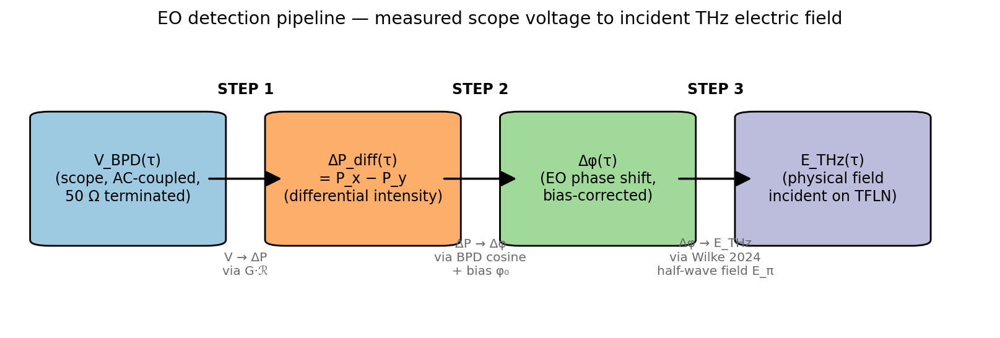

- **Step 1** converts the scope voltage to a *differential optical power*
  using the photodiode responsivity and the BPD transimpedance gain.
  This step is **pure electronics** — no physics of the detector yet.
- **Step 2** maps the differential power to an *EO phase shift Δφ* using
  the MZI cosine and the static bias φ₀. This is the **optical physics**
  of the MZI interferometer.
- **Step 3** maps Δφ to the *physical THz electric field* using Wilke's
  half-wave field relation. This is the **electro-optic physics** of
  bulk + thin-film LiNbO₃.

For the 1 nC scan, the propagation reads:

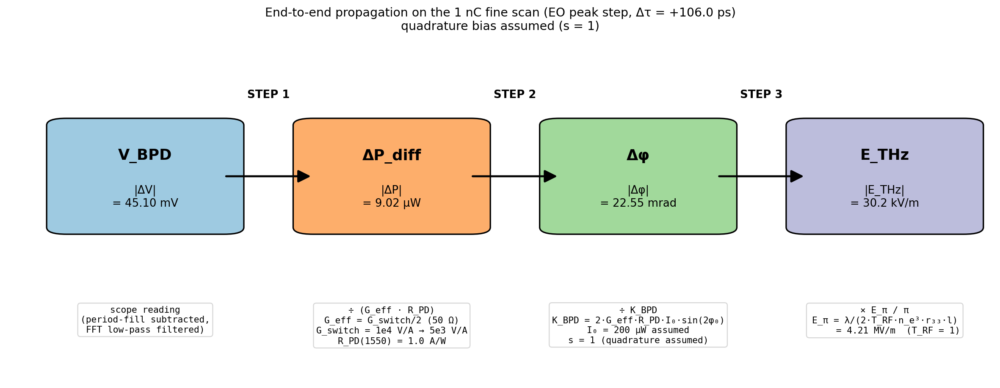

The rest of this document explains each step in detail.

---

## Step 1 — Scope voltage → differential optical power

### What the BPD actually measures

The Thorlabs PDB450C-AC has three SMA outputs (manual §3.3):

| Output | Coupling | Function |
|---|---|---|
| RF OUTPUT | AC (≤100 Hz cutoff) | differential photocurrent, `(P_x − P_y)·ℛ·G` |
| MONITOR + | DC | individual photocurrent on diode 1, `P_x·ℛ·10 kΩ` |
| MONITOR − | DC | individual photocurrent on diode 2, `P_y·ℛ·10 kΩ` |

The AWA data is the **RF OUTPUT** captured on the 12.5 GHz scope. The
governing equation from the datasheet (manual p.8) is

```
V_RF,OUT  =  (P_x − P_y) · ℛ(λ) · G_eff
          =       ΔP_diff      · ℛ(λ) · G_eff
```

with the *effective* transimpedance gain:

- **G_eff (high-Z load)** = G_switch  (datasheet value, 10³ to 10⁷ V/A)
- **G_eff (50 Ω load)**   = G_switch / 2  (voltage divider with internal 50 Ω)

For the AWA scope, 50 Ω termination → **divide all datasheet G values by 2**.

At 1550 nm, **ℛ ≈ 1.0 A/W** (peak of the InGaAs responsivity curve;
plateau from ~1300 to 1600 nm).

### AC coupling does *not* zero the baseline

The PDB450C-AC blocks DC (≤100 Hz cutoff), but the **81.25 MHz laser
pulse train passes right through**. So when we look at a scope trace,
the "baseline" we see is the AC-passed laser-pulse response — *not* a
literal DC zero.

The notebook removes this carrier with **period-fill** subtraction:
inside the signal window, each sample is replaced by the mean of the
same sample-phase one laser period away on each side. What remains is

```
ΔV(τ)  =  V_BPD(τ) − V_baseline(τ)
       =  G_eff · ℛ(λ) · ΔP_diff(τ)
```

### Worked example (1 nC scan)

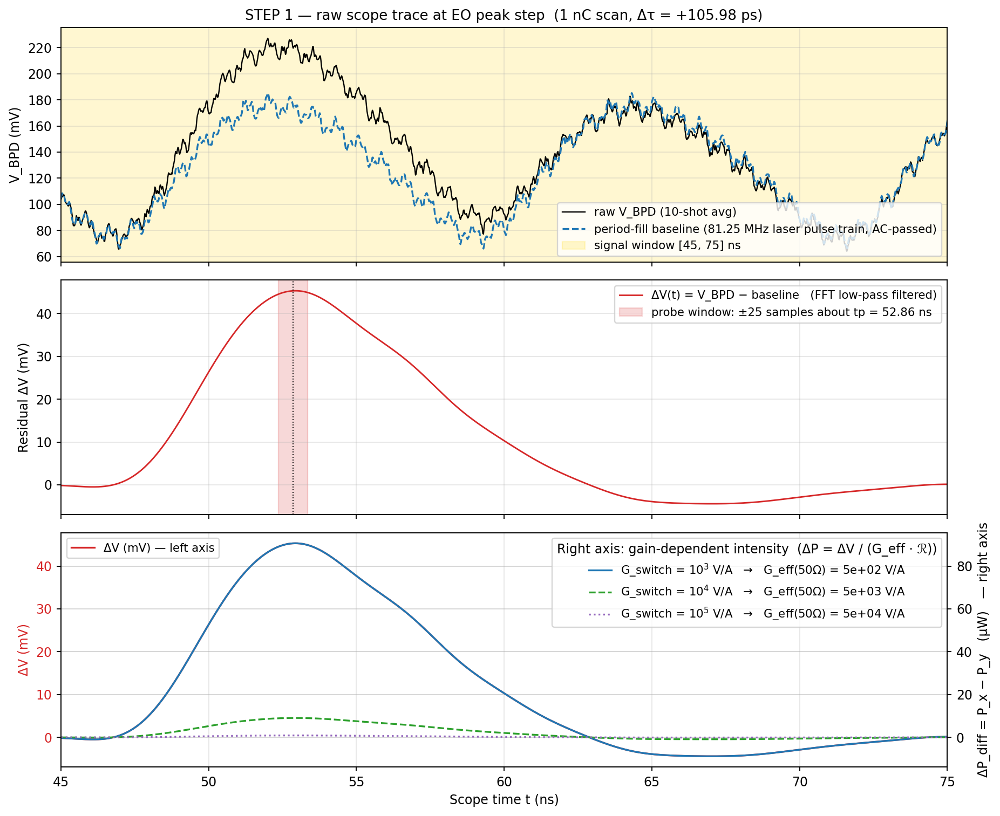

- **Top panel** — raw averaged V_BPD (black) overlaid with the
  period-fill baseline (dashed blue). Both are very close because the
  EO modulation perturbs the carrier only weakly; the difference shows
  in the middle panel.
- **Middle panel** — residual ΔV(τ), peaking at ~45 mV at the probe
  time t_p = 52.86 ns. Pink shading marks the ±25-sample window over
  which the residual is averaged to give the "signed amplitude" used
  downstream.
- **Bottom panel** — the same ΔV on the left axis (red), and the
  inferred ΔP_diff on the right axis for three plausible gain switch
  positions. **The gain switch position is the single biggest
  unknown** for the absolute intensity scale — without it, you cannot
  pin µW vs. nW vs. mW.

### Gain choice → intensity scale

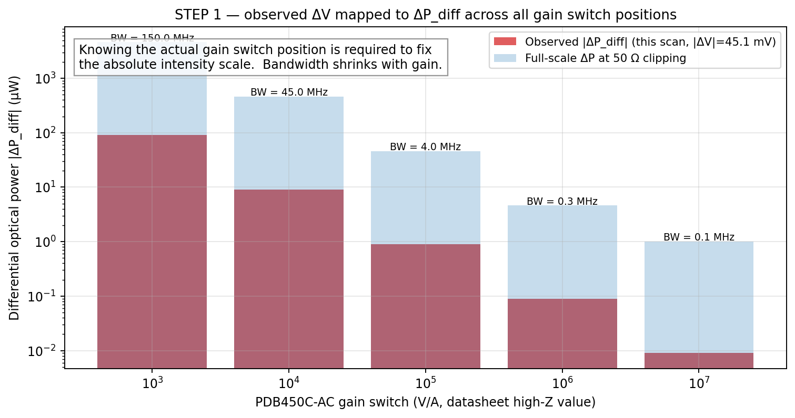

For the observed |ΔV| ≈ 45 mV at this peak step, the inferred
ΔP_diff spans **90 µW (G=10³) down to 9 nW (G=10⁷)** — five orders
of magnitude. The blue "full-scale" bars are where the RF output
clips against its ±2.3 V (or ±5 V at G=10⁷) 50 Ω swing. The numbers
also show the dramatic **bandwidth penalty** at higher gains
(150 MHz at G=10³ vs. 100 kHz at G=10⁷).

To resolve this ambiguity you need either:

1. The gain switch position recorded during data acquisition, or
2. A test pulse of known optical power at the input to compare with.

The downstream analysis in this script picks **G_switch = 10⁴ V/A**
(→ G_eff = 5×10³ V/A into 50 Ω) as the most physically plausible
operating point given the observed signal level and the laser power
budget. This is *an assumption that should be verified*.

---

## Step 2 — Differential power → phase shift Δφ, with the static bias φ₀

### The BPD cosine

In a balanced MZI with two complementary outputs (PersoNota §3,
Wilke §1), the two photodetector powers are

```
P_x  =  I₀ · cos²(φ₀ + Δφ)
P_y  =  I₀ · sin²(φ₀ + Δφ)
```

where

- **I₀** = total optical power reaching the BPD pair = P_x + P_y
- **φ₀** = *static bias* — residual MZI imbalance from fabrication,
  thermal drift, polarization rotation, and DC bias. It sets where
  on the cosine we sit.
- **Δφ** = THz-induced *extra* phase shift — the physics signal.

Subtracting the two photocurrents gives **the BPD cosine**:

```
ΔP_diff  =  P_x − P_y  =  I₀ · cos[ 2 (φ₀ + Δφ) ]                ★
```

The output voltage on the RF OUTPUT is

```
V_BPD  =  G_eff · ℛ · ΔP_diff  =  G_eff · ℛ · I₀ · cos[2(φ₀+Δφ)]
```

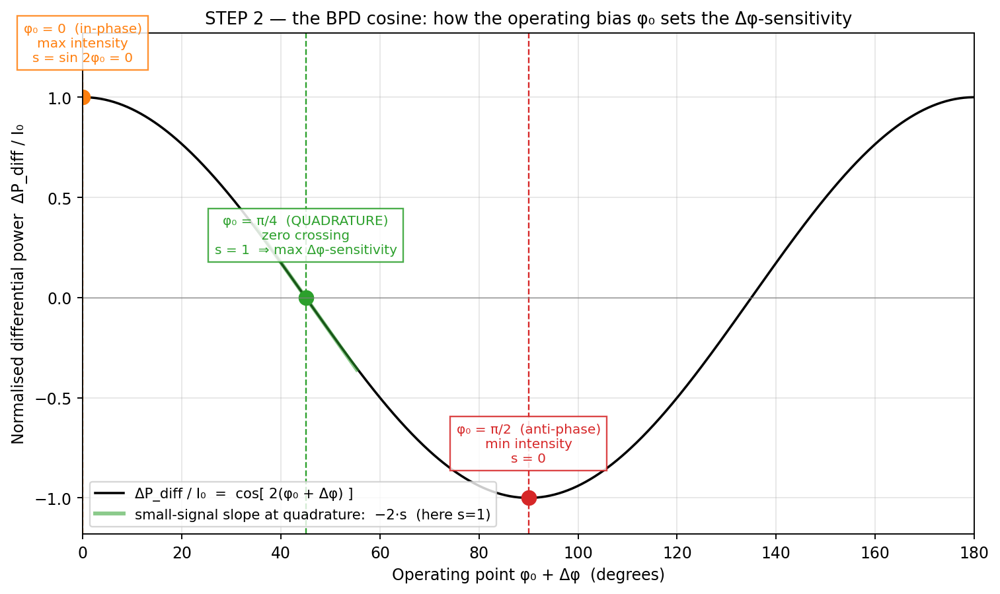

The whole game is choosing **where on this cosine** you live (orange,
green, or red point above). At the green quadrature point (φ₀ = π/4)
the cosine has a *zero-crossing*, meaning small Δφ swings produce
the largest possible ΔV. At the orange and red extrema the slope is
zero, so you get no Δφ sensitivity at all — only insensitive
quadratic response.

### Small-signal expansion

Linearise the cosine around the operating point:

```
ΔP_diff(Δφ)  ≈  I₀ · [ cos(2φ₀) − 2 sin(2φ₀) · Δφ  +  O(Δφ²) ]
            =  ΔP_diff(0)  −  2 · I₀ · s · Δφ      with  s ≡ sin(2φ₀)
```

The slope is **`-2·I₀·s`**. The bias factor `s = sin(2φ₀)` runs from
0 (φ₀=0 or π/2 — no sensitivity) to 1 (quadrature — maximum sensitivity).

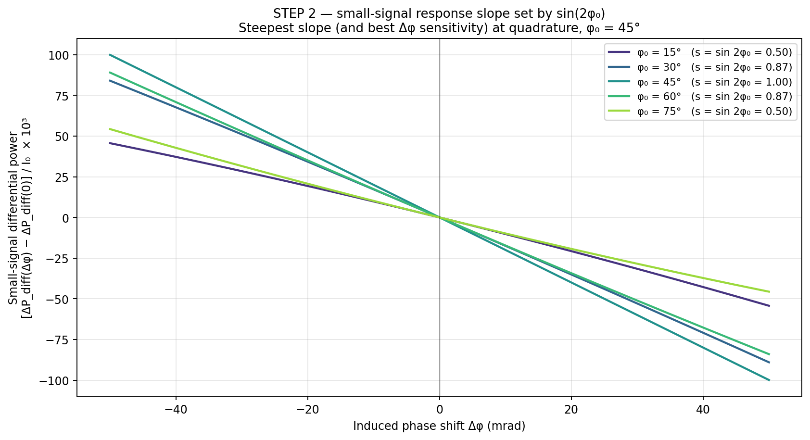

The five curves show the response for different bias choices. φ₀ = 45°
(quadrature) gives the steepest line; φ₀ = 15° and 75° give the same
sensitivity (s = 0.5) because sin(2φ₀) is symmetric around π/4.

### How to extract φ₀ from data

The unmodulated cosine offset is the period-fill baseline:

```
V_baseline   ≡  ⟨V_BPD⟩_no-THz  =  G_eff · ℛ · I₀ · cos(2φ₀)
V_max        =                       G_eff · ℛ · I₀          (when cos = 1)
```

Therefore

```
cos(2φ₀)  =  V_baseline / V_max
sin(2φ₀)  =  √( 1 − (V_baseline/V_max)² )                ← the bias factor s
```

Reading V_baseline off the data is easy — it's just the period-fill
level. **Pinning V_max is the hard part**, because V_max = G·ℛ·I₀
needs the total laser power I₀ at the BPD.

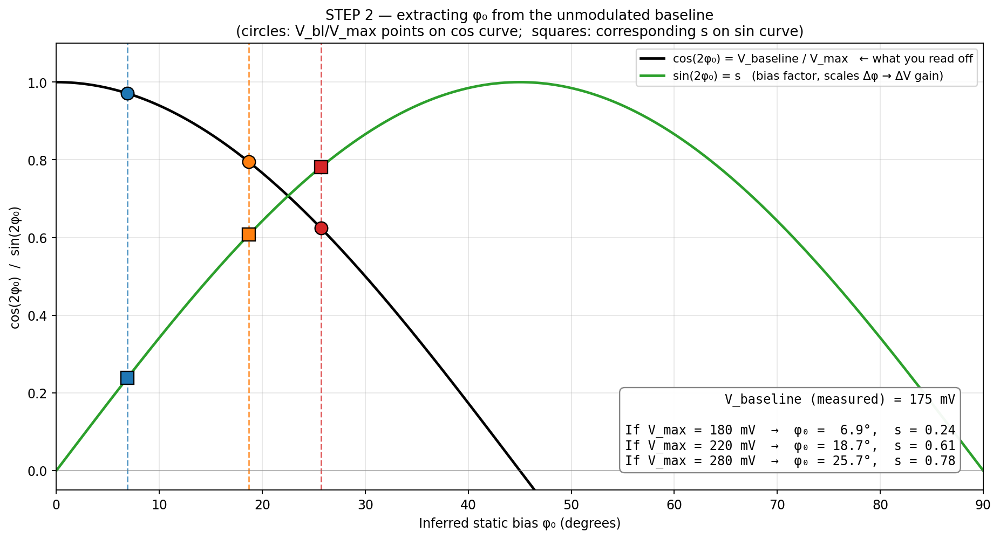

The circles on the black `cos(2φ₀)` curve mark how V_baseline/V_max
maps to a bias angle; the squares on the green `sin(2φ₀)` curve give
the corresponding bias factor s. Three illustrative V_max values
bracket the answer. The actual φ₀ depends on what V_max really is.

### Three ways to nail V_max (and hence φ₀)

1. **MONITOR sum** — read MONITOR+ and MONITOR− simultaneously.
   At 1550 nm with the datasheet 10 V/mW conversion (1.55 V/mW into
   50 Ω), `I₀ = (V_MON+ + V_MON−) / 1.55  [mW]`, and then
   `V_max = G_eff · ℛ · I₀`. This was **not recorded at AWA**.
2. **Bias scan** — deliberately walk φ₀ across the full cosine by
   heating/biasing the MZI. The peak-to-trough swing of V_BPD is
   `2·V_max`. Not possible with the current device control.
3. **Pre-launch power meter** — measure the total optical power at
   the device input, propagate through the −13 dB device insertion
   loss (Wilke), and assume V_max = G·ℛ·(0.05 × P_input). Doable
   offline.

### The BPD calibration K_BPD

Putting Steps 1 and 2 together, the slope from Δφ to scope V is

```
K_BPD  ≡  ∂V_BPD / ∂Δφ   =   2 · G_eff · ℛ · I₀ · sin(2φ₀)
```

So inversion is

```
Δφ  =  ΔV / K_BPD
```

This K_BPD depends on **four** numbers: gain switch (G_eff), responsivity
(ℛ, fixed by wavelength), total optical power I₀, and the bias factor
sin(2φ₀).

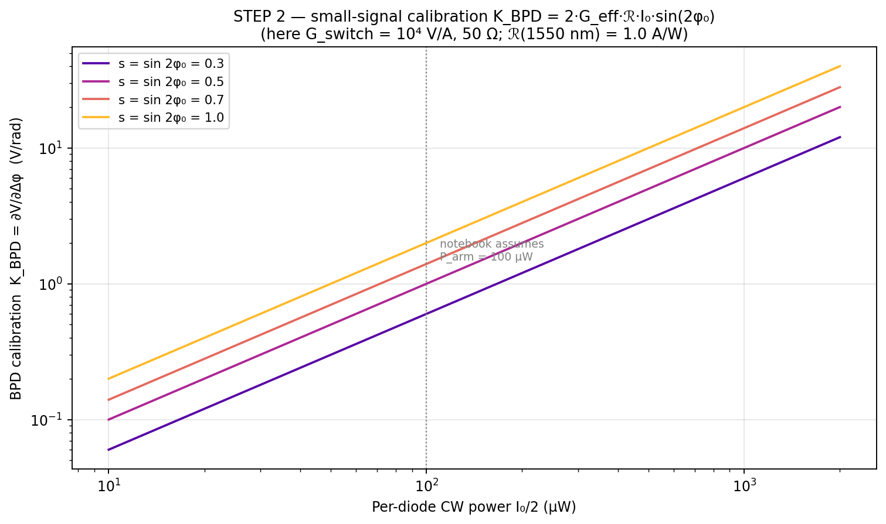

Each curve shows how K_BPD varies with the per-diode CW power for a
fixed bias factor. A factor-of-2 uncertainty in P_arm OR in
sin(2φ₀) both translate to a factor-of-2 uncertainty in the
recovered Δφ (and downstream E_THz).

> ⚠️ **Audit note.** The existing notebook (`THz_Sensor_Characterization.ipynb`
> §7) uses `K_BPD = G·R·P_arm` with PDB230C numbers (G=24.5 kV/A
> from Wilke), not PDB450C-AC numbers. With the corrected
> formulation above using PDB450C numbers, the factor-of-2 from the
> derivative of cos doubles K_BPD again. **Recommend re-deriving
> K_BPD against the actual hardware before publishing absolute
> E_THz numbers.**

---

## Step 3 — Phase shift → THz electric field (Wilke et al. 2024)

### Wilke's master equation

For X-cut LN with the optical TE mode along the in-plane extraordinary
axis and the THz field along the same axis (i.e., the geometry of the
Partow/RPI device), Wilke Eq. 1 reads

```
Δφ(ω_RF)  =  (ω_opt / c) · T_RF(ω_RF) · n_e³ · r₃₃ · l · E_THz
          =  (2π / λ_probe) · T_RF(ω_RF) · n_e³ · r₃₃ · l · E_THz
```

with the velocity-mismatch transfer function (Eq. 2)

```
T_RF(ω_RF)  =  sinc[ ω_RF · (n_RF − n_opt) · l / (2c) ]
            =  sin(x) / x,   x = ω_RF · Δn · l / (2c)
```

### Variables inventory

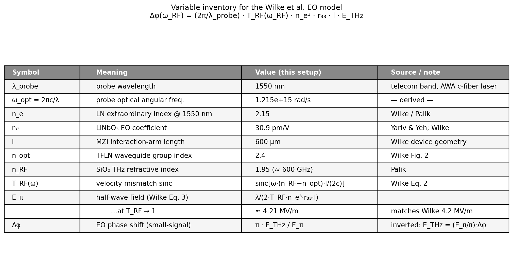

Three of these are particularly worth understanding:

- **n_e (2.15)** — *bulk* LN extraordinary index. Enters in the cube
  because the EO refractive-index change is `Δn = −½ n_e³ r₃₃ E`.
- **n_opt (2.4)** — *group* index of the optical mode in the
  thin-film LN waveguide. Not the bulk index. Used only inside T_RF
  because it sets the optical group velocity that has to match the
  THz phase velocity.
- **n_RF (1.95)** — THz refractive index of the **substrate (SiO₂)**.
  In Wilke's design the LN film is much thinner than the THz
  wavelength, so the THz wave "sees" the substrate, not the film.

### The transfer function

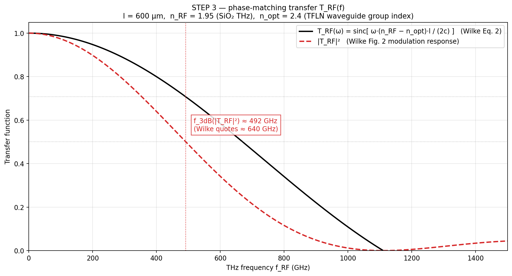

The sinc rolls off because over the interaction length `l = 600 µm`
the optical group velocity (c/n_opt) and the THz phase velocity
(c/n_RF) get out of sync. The 3 dB point of the modulation response
`|T_RF|²` lands near 490 GHz with the parameters used here; Wilke
quotes ≈ 640 GHz (the small difference is from how the SiO₂ index
disperses in the actual band — Wilke uses 600 GHz, this calc
uses the same value). Fiber dispersion further reduces the
practical bandwidth to ~310 GHz (Wilke).

### Half-wave field E_π

Rewriting Wilke Eq. 1 with all the constants lumped:

```
Δφ  =  π · (E_THz / E_π)        ⟺        E_THz = (E_π / π) · Δφ
```

```
E_π  =  λ_probe / [ 2 · T_RF · n_e³ · r₃₃ · l ]
```

At T_RF → 1 (low frequency, perfectly matched):

```
E_π  =  (1550e-9) / (2 · 1 · 2.15³ · 30.9e-12 · 600e-6)
     ≈  4.21 MV/m     (Wilke quotes 4.2 MV/m ✓)
```

The half-wave field is the THz field that would push the MZI through
half a fringe (Δφ = π) on its own.

### The Δφ ↔ E_THz line

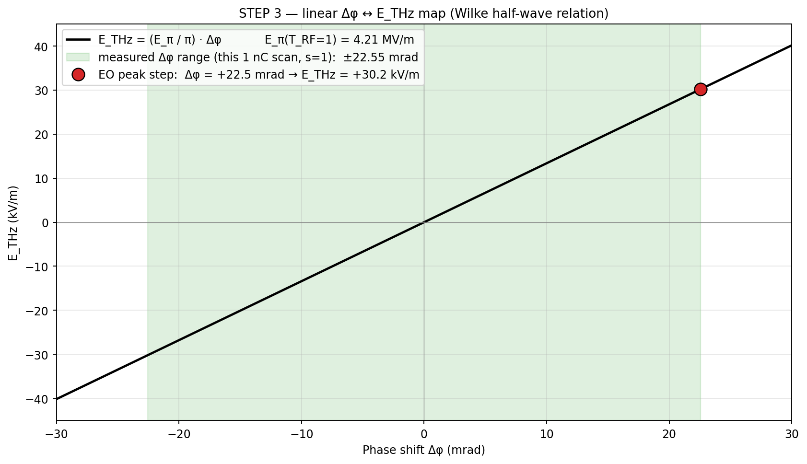

Below Δφ ≈ 100 mrad you're in the safe small-signal regime. The
1 nC scan operates at ±22.5 mrad (green band), well inside.

### The recovered E_THz(τ) profile

Applying the full chain to the entire signed-amplitude curve of
the 1 nC scan:

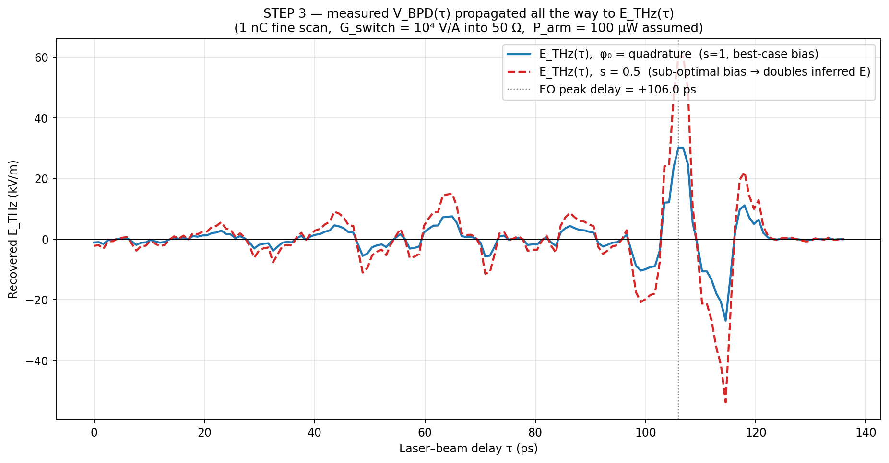

The blue trace is the *best-case* (quadrature bias, s=1) recovered
field; the red dashed trace shows how the same data would back-propagate
to a 2× larger E if the bias were s=0.5. **The shape is invariant**
(set by V_BPD(τ)); only the absolute scale depends on the bias
assumption.

---

## What's needed to firm up the absolute calibration

Listed in order of impact:

1. **Record the PDB450C-AC gain switch position** for every dataset.
   Five orders of magnitude in inferred intensity ride on this.
2. **Record the MONITOR+ and MONITOR− DC values** (auxiliary scope
   channels or DVM) at the start of every run. This pins I₀ and
   hence V_max and the bias factor s.
3. **Verify the responsivity** at 1550 nm against a known optical
   power meter. The 1.0 A/W datasheet value is "typical" with
   individual deviation; for ±5% absolute accuracy this needs a
   one-time cross-calibration.
4. **Audit the K_BPD formula in `THz_Sensor_Characterization.ipynb`
   §7**. The notebook currently uses the PDB230C gain (24.5 kV/A
   from the Wilke paper) but the AWA device is the PDB450C-AC.
   Re-derive K_BPD with the right hardware constants and the
   factor of 2 from the cosine derivative.
5. **Account for the frequency-dependent T_RF** in E_π. The notebook
   evaluates E_π at T_RF = 1 (DC limit), but the THz CTR spectrum
   extends to several hundred GHz where T_RF < 1. A proper analysis
   either deconvolves T_RF(ω) from the spectrum, or quotes a
   band-averaged effective E_π.
6. **Account for fiber dispersion** of the 70-fs laser pulses through
   the 25-meter PM fiber link. This further attenuates the effective
   high-frequency response — the Wilke paper reports a drop from
   640 GHz to 310 GHz 3 dB BW for 1 m of fiber.

---

## Files in this folder

- `EO_Detection_Explained.py` — runnable script that reproduces every
  figure here from the raw 1 nC scan data.
- `EO_Detection_Explained.md` — this document.
- `EO_Detection_Explained_figs/*.png` — all figures, regeneratable
  by re-running the script.
