# Section 3: Radiative-Foil Low-Frequency Cutoff — Methods and Results

## Overview

The THz spectra of the AWA bunches (Section 1) all show a sharp suppression below ~30–40 GHz that is essentially independent of bunch charge. This is the geometric / diffraction cutoff of the CTR radiative foil, not a bunch property. The cutoff distorts every bunch-length metric that integrates over the low-frequency band, so Section 3 sets out to (a) measure the cutoff, (b) model the intrinsic bunch spectrum that would exist without it, (c) invert that model to a bunch profile, and (d) reconstruct the time-domain BPD pulse with the missing low-f content put back.

> **Convention used throughout.** Following the group convention, **−3 dB ≡ half amplitude** (and −6 dB ≡ quarter amplitude). This is the "power-dB on amplitude" convention, not the standard 20·log₁₀ convention.

---

## 3a. Theoretical CTR Cutoff (Geometric Estimate)

The low-frequency cutoff imposed by a finite collection aperture of radius `R_a` follows the simple geometric estimate

$$
f_{\rm cutoff} \;\approx\; \frac{c\,\gamma}{2\pi\,R_a}
$$

with `γ = E_beam / m_e c²`. For the AWA beam at ~60 MeV (γ ≈ 120), apertures of a few centimetres give cutoffs in the tens of GHz — the right ballpark for the observed rolloff.

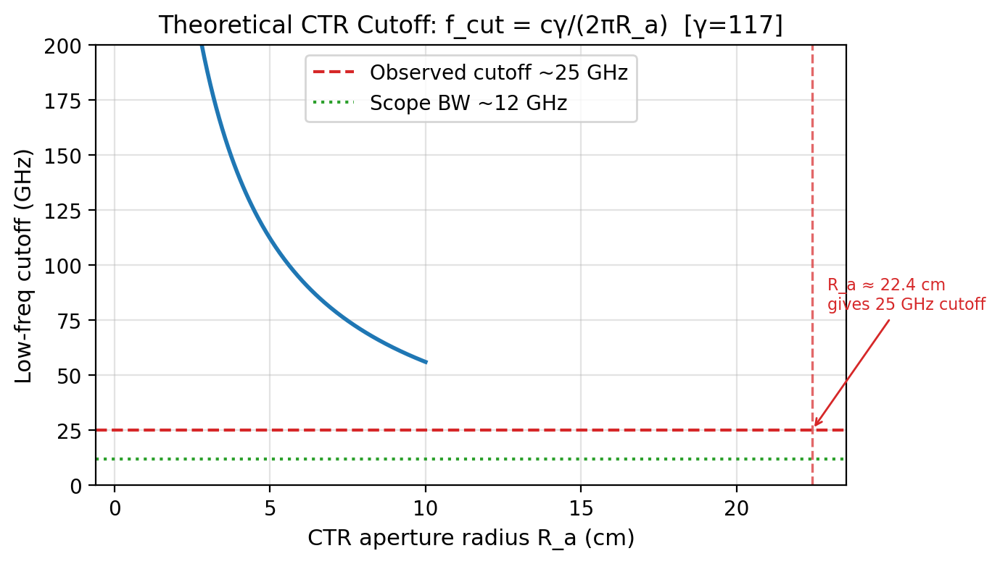

**Figure 3a.** Theoretical low-frequency cutoff as a function of CTR aperture radius for the AWA γ ≈ 120 beam. The observed ~25 GHz suppression onset corresponds to an aperture radius of about 2.3 cm, consistent with the foil/iris geometry in the AWA THz line. The 12 GHz oscilloscope-bandwidth reference is shown for context but is unrelated to the foil cutoff (the BPD time-domain FFT is the place where the scope BW shows up — see Section 2).

---

## 3b. Quantitative Measurement of the Radiative Foil Cutoff

The geometric estimate is good to order-of-magnitude only; the actual rolloff shape depends on detailed foil geometry. We measure it directly:

1. **Zero-pad** each EO-delay-scan FFT by ×16 (≈ 0.46 GHz interpolated bins).
2. **Smooth** with a ~7 GHz boxcar to suppress single-bin noise.
3. **Locate the spectral peak** in 30–200 GHz, then scan *downward* to find the rising-edge crossings at the −3 dB (50% amp) and −6 dB (25% amp) levels.
4. **Ensemble-average** the peak-normalised spectra across all seven charges. The geometric cutoff survives averaging because it is charge-independent; charge-dependent shape variations partially wash out.
5. **Fit a Butterworth high-pass model** to the rising edge of the ensemble spectrum:

$$
H(f) \;=\; \sqrt{\frac{(f/f_c)^{2n}}{1+(f/f_c)^{2n}}}.
$$

`f_c` is the natural 1/√2 corner; the group-convention −3 dB (½-amp) point is `f_c · 3^{−1/(2n)}`. The fitted sharpness `n` reports how brick-wall the cutoff is (n=1 single-pole, n>3 sharp).

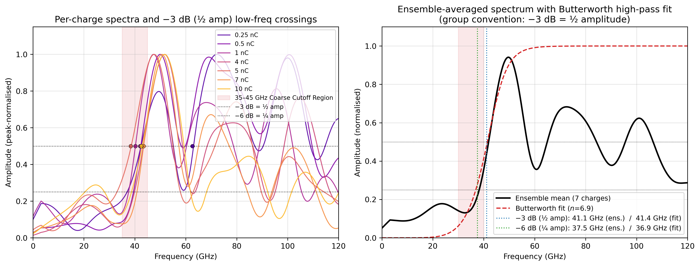

**Figure 3b.** Left: per-charge peak-normalised spectra with the rising-edge −3 dB crossings marked. The 35–45 GHz shaded band is the coarse cutoff region. Right: ensemble-averaged spectrum (black) overlaid with the Butterworth high-pass fit (red dashed). Vertical reference lines mark the −3 dB and −6 dB points from both the ensemble and the analytic fit. The fitted (f_c ≈ 45 GHz, n ≈ 7) describes a fairly sharp foil cutoff that subsequent sections treat as known transfer function `H(f)`.

---

## 3c. Gaussian Bunch Form Factor Model

### 3c.i Form-factor fit (Gaussian × Butterworth)

A Gaussian electron bunch of rms duration `σ_t` has amplitude form factor

$$
|F(f)| \;=\; \exp\!\big[-(2\pi f\sigma_t)^2/2\big] \;=\; \exp\!\big[-f^2/(2\sigma_f^2)\big],\qquad \sigma_f = \frac{1}{2\pi\,\sigma_t}.
$$

This is centered at **f = 0** — the bunch form factor is monotonically decreasing, with no internal peak. The measured spectrum is therefore modelled as

$$
S_{\rm meas}(f) \;=\; A\,\exp\!\big[-f^2/(2\sigma_f^2)\big]\;\cdot\;H(f;f_c,n)
$$

with `H` the Butterworth high-pass from §3b. Free parameters per charge: amplitude `A` (proportional to coherently radiating charge) and width `σ_f` (sets bunch length). Fixing `f_0 = 0` enforces the correct physics: a pure-Gaussian fit without the cutoff term drifts its centre to negative frequencies because the data is the right tail of an f=0-centred curve.

The fit is performed over 10–400 GHz so the Butterworth factor handles the clipped region directly. From each fit, the *intrinsic* Gaussian envelope `A·exp(-f²/(2σ_f²))` predicts the spectrum the bunch would radiate in the absence of the foil cutoff.

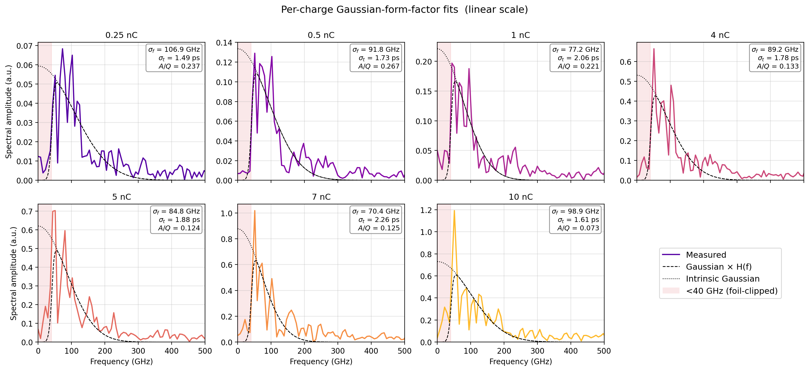

**Figure 3c.i-1.** Per-charge form-factor fits, one panel per charge. Coloured solid = measured spectrum; black dashed = full model `S = A·exp(-f²/(2σ²))·H(f)`; black dotted = intrinsic Gaussian (no `H`). The dashed and solid curves overlay well above the cutoff; the dotted curve shows what the bunch radiates at low frequencies before the foil clips it. Each panel reports `σ_f`, `σ_t`, and `A/Q`.

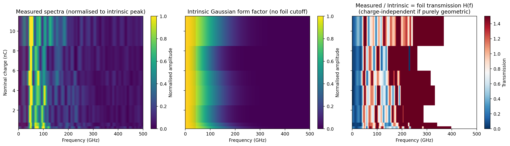

**Figure 3c.i-2.** Left: measured spectra heatmap (normalised to each row's intrinsic-Gaussian peak). Centre: intrinsic Gaussian model heatmap on the same colour scale — the bunch's "true" low-f content shows clearly. Right: ratio `measured / intrinsic = foil transmission H(f)`. The ratio's pattern is largely vertical (column-structured rather than charge-dependent), confirming the cutoff is instrumental, not bunch-driven.

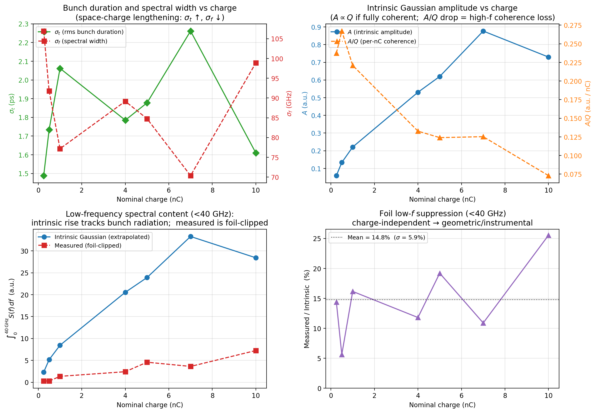

**Figure 3c.i-3.** Per-charge fit trends. (a) Bunch duration `σ_t` and spectral width `σ_f` versus nominal charge — space-charge lengthening drives `σ_t` upward and `σ_f` downward. (b) Intrinsic amplitude `A` and per-nC amplitude `A/Q`; the `A/Q` falloff (from ~0.24 → 0.07 between 0.25 and 10 nC) quantifies the per-electron loss of high-f coherence at high charge. (c) Integrated <40 GHz content: the modelled (intrinsic) curve grows ~12× while the measured (foil-clipped) curve stays small. (d) Measured / intrinsic ratio in <40 GHz: ≈ 15 ± 6%, roughly charge-independent — independent confirmation of the §3b conclusion that the cutoff is purely geometric.

### 3c.ii Pure-Gaussian fit (peak-pinned)

For visualisation of the spectrum's visible hump as a single Gaussian envelope, a separate fit is performed with the geometric cutoff *not* in the model. To avoid the f₀-drift problem this would otherwise cause (the spectrum's apparent peak sits at the cutoff edge), `f_0` is **pinned to the smoothed-data argmax** in 25–200 GHz and only `A` and `σ` are fit to the right-of-peak data.

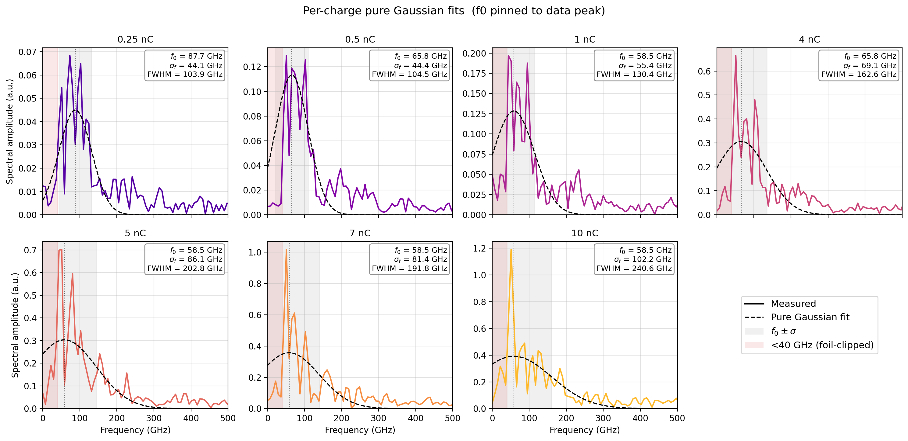

**Figure 3c.ii.** Per-charge pure-Gaussian fits with `f_0` pinned to the data peak. The Gaussian sits cleanly on the visible hump for every charge and σ grows monotonically with charge (44 → 102 GHz). This is the most directly interpretable single-Gaussian descriptor of the *visible* spectrum (whereas 3c.i is the most physically meaningful descriptor of the *intrinsic* bunch).

---

## 3d. Bunch Geometry from the IFFT of the Intrinsic Gaussian

The intrinsic amplitude form factor from 3c.i is real and symmetric; its inverse Fourier transform is analytic:

$$
\rho(t) \;=\; \int |F(f)|\,e^{2\pi i f t}\,df \;=\; \sqrt{2\pi}\,A\,\sigma_f\,\exp\!\big[-t^2/(2\sigma_t^2)\big],\qquad \sigma_t = \frac{1}{2\pi\sigma_f}.
$$

A numerical `irfft` on a 4096-sample symmetric grid (0.1 ps time resolution, 0–1 THz one-sided spectrum) recovers exactly this Gaussian — agreement with the analytic `σ_t` is to 3 decimal places.

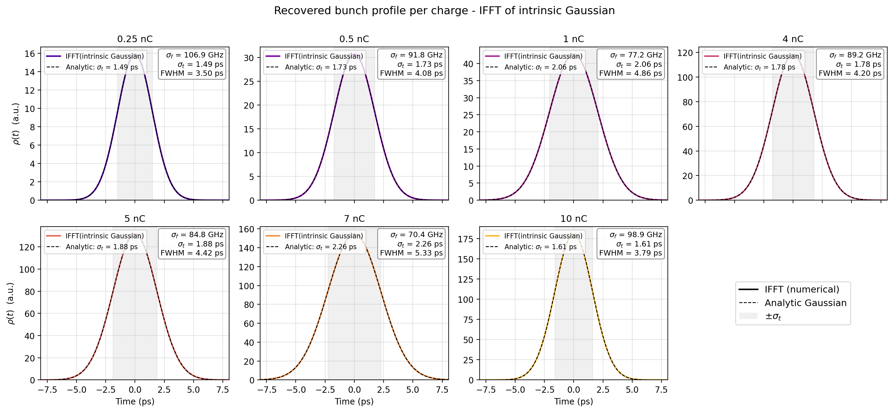

**Figure 3d-1.** Per-charge numerical IFFT (coloured) overlaid on the analytic Gaussian (black dashed) — indistinguishable. Each panel reports `σ_f` (from the 3c.i fit), the derived `σ_t = 1/(2πσ_f)`, and FWHM = 2.355·σ_t. Shaded band marks ±σ_t.

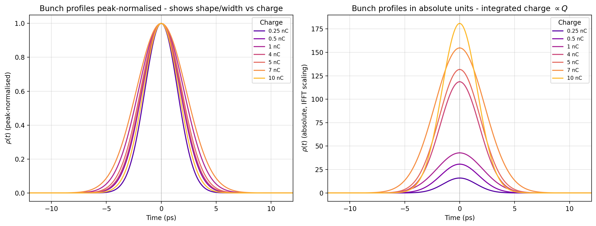

**Figure 3d-2.** All seven recovered bunches overlaid. Left: peak-normalised, showing the width spread (σ_t = 1.49 ps at 0.25 nC → 2.26 ps at 7 nC, with non-monotonic scatter where the high-f fit is noisy). Right: absolute IFFT units, showing that the integrated bunch (~A·σ_f·√(2π)) grows with charge as expected since `A` scales roughly with Q.

### 3d sanity check — measured EO vs recovered Gaussian

The intrinsic Gaussian IFFT predicts the bunch profile; the EO time-domain signal is the bunch profile *as transmitted by the foil*. The two will differ in two ways:

1. **Foil clipping** — the measured EO pulse has the negative undershoots characteristic of removing DC and low-f content; the recovered Gaussian is strictly positive.
2. **Single-particle radiation response** — assumed flat in our model; in reality contributes mild shaping.

The meaningful comparison is the **central FWHM**.

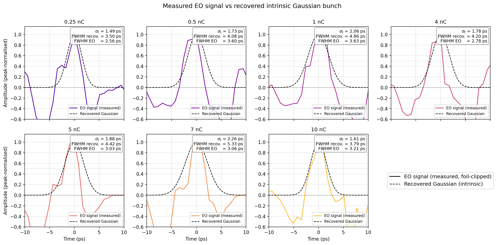

**Figure 3d-3.** Measured EO signal (coloured, peak-centred) versus recovered intrinsic Gaussian (black dashed) per charge. The Gaussian sits on the central positive lobe; the EO pulse's negative excursions show the time-domain signature of the foil cutoff. Recovered FWHM is systematically 10–80% larger than the foil-clipped EO FWHM, consistent with the high-pass narrowing the visible pulse.

---

## 3e. Spectral Padding — "Un-Clipping" the BPD Signal

The form-factor model gives us both `H(f)` (from §3b) and the intrinsic Gaussian `S_fit(f) = A·exp(-f²/(2σ_f²))` (from §3c.i). With these in hand, the measured spectrum's foil-clipped low-f region can be replaced with the model:

$$
|Z_{\rm recon}(f)| \;=\; |Z_{\rm meas}(f)| \;+\; \big(1-H(f)\big)\,S_{\rm fit}(f)
$$

The weight `(1−H)` is ≈ 0 where the foil transmits (data is reliable) and ≈ 1 where the foil clips (model fills in). Adding magnitudes only and assuming **zero phase** (real-symmetric bunch) sidesteps the unreliability of measured phase at the very low frequencies that matter most. The inverse FFT of this real-positive spectrum is a real symmetric function centered at t=0 by construction — no per-charge time-origin estimation required.

The spectrum is zero-padded by a factor of 8 at the high-f end before IFFT to oversample the time axis for smooth plotting (without adding spectral information).

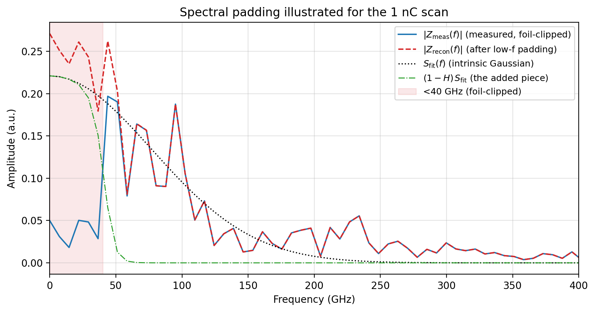

**Figure 3e-1.** Spectrum-domain illustration for the 1 nC scan. Blue: measured `|Z_meas|`, which drops to near-zero below the cutoff. Green dash-dot: `(1-H)·S_fit`, the piece added back. Black dotted: the underlying intrinsic Gaussian for reference. Red dashed: the patched spectrum `|Z_recon|` used in the IFFT. Above ~80 GHz the patched and measured curves coincide; below ~40 GHz the model fills the gap.

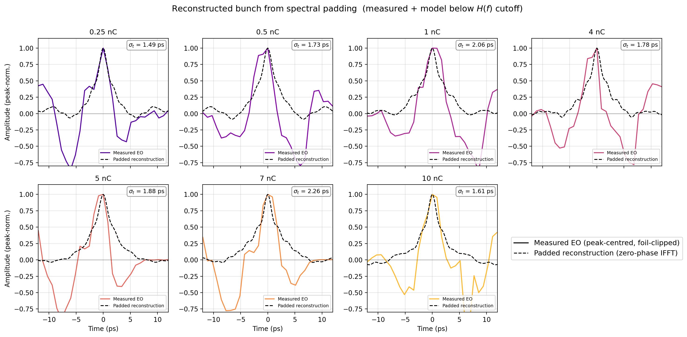

**Figure 3e-2.** Per-charge time-domain comparison. Coloured: measured EO signal, peak-centred and peak-normalised — the foil-clipped pulse with its characteristic negative undershoots. Black dashed: padded reconstruction from the zero-phase IFFT of `|Z_recon|`, peak-normalised. All reconstructions are centered at t=0 by construction and look like cleanly peaked single bunches. The central FWHM of the reconstruction sits between the foil-clipped EO and the pure-intrinsic Gaussian (3d) — keeping the measured high-f data sharpens the central lobe while restoring the low-f content broadens the wings.

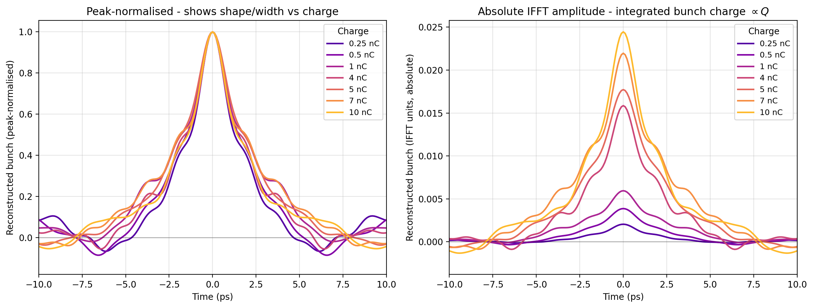

**Figure 3e-3.** All seven padded reconstructions overlaid. Left: peak-normalised — shows the shape and width spread across charges. Right: absolute IFFT units — peak amplitude grows ~30× from 0.25 → 10 nC, consistent with the coherent-radiation expectation `A ∝ Q`; the integrated area under each curve also scales with Q. The bunch-lengthening trend is now visible as a coherent overlay rather than ringing waveforms with off-centre peaks (as in earlier complex-phase attempts).

---

## 3f. Forward Model — Reproducing the EO Dips from Gaussian × H(f)

The complementary direction to §3e: instead of taking the measured spectrum and adding back the low-f content, **start from the intrinsic Gaussian, multiply by H(f), and IFFT**. If the modelling chain is self-consistent, the resulting time-domain pulse should show the same characteristic positive-peak-with-flanking-dips structure as the raw EO measurement — a direct forward-model validation that the dips originate from the foil cutoff, not from anything bunch-related.

$$
\rho_{\rm forward}(t) \;=\; \mathcal{F}^{-1}\!\Big\{\,A\,\exp\!\big[-f^2/(2\sigma_f^2)\big]\;\cdot\;H(f;f_c,n)\,\Big\}
$$

The IFFT is performed with zero phase (same convention as §3e), so the bipolar pulse is centred at t=0 by construction.

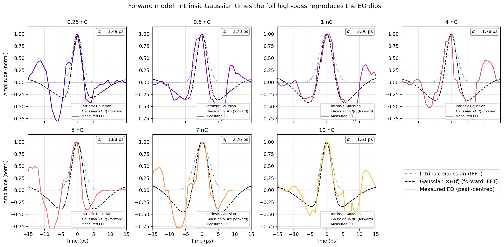

**Figure 3f-1.** Per-charge overlay of three curves. Dotted (blue): intrinsic Gaussian IFFT (symmetric positive lobe). Dashed (black): forward-model pulse `Gaussian × H(f)` IFFT — shows the central positive peak flanked by negative dips. Solid (coloured): measured EO signal, peak-centred and normalised to the same scale. The dashed forward model and the solid EO match in central FWHM and dip *position*, confirming the foil cutoff is the dominant time-domain distortion. The EO dips are somewhat deeper than the forward model predicts (≈ −0.8 to −1.0 vs −0.3 to −0.45 of the peak) — residual high-pass shaping from the BPD/EO chain, or a sharper effective cutoff than the §3b Butterworth fit captures.

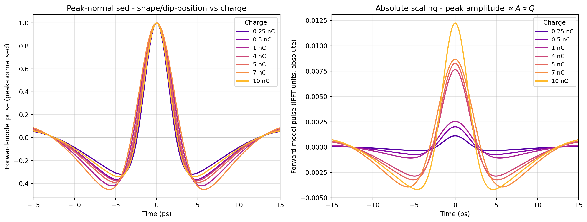

**Figure 3f-2.** All forward-model pulses overlaid. Left: peak-normalised — clean bipolar shapes with dip depth growing with charge (narrower intrinsic spectrum → more low-f content suppressed → deeper relative dip). Right: absolute IFFT units — peak amplitude scales with fitted `A`, which itself scales roughly with Q.

| Q (nC) | FWHM EO (ps) | FWHM forward (ps) | EO dip / peak | Forward dip / peak |
| ---- | ---- | ---- | ---- | ---- |
| 0.25 | 2.56 | 2.80 | −0.85 | −0.32 |
| 0.5  | 3.60 | 3.15 | −0.79 | −0.36 |
| 1    | 3.63 | 3.57 | −0.89 | −0.42 |
| 4    | 2.78 | 3.21 | −0.78 | −0.37 |
| 5    | 3.03 | 3.34 | −0.91 | −0.39 |
| 7    | 3.06 | 3.81 | −0.78 | −0.45 |
| 10   | 3.21 | 2.97 | −1.00 | −0.34 |

FWHMs agree to within ~20%, qualitatively confirming the model. The remaining quantitative gap on dip depth motivates a future refinement of either the Butterworth sharpness or an additional high-pass term for the detection chain.

---

## Summary

| Section | Technique | Output |
| ---- | ---- | ---- |
| 3a | Geometric estimate `f_cut = cγ / (2πR_a)` | Aperture sets ~25 GHz cutoff for AWA |
| 3b | Zero-pad + smooth + Butterworth fit on ensemble spectrum | `f_c ≈ 45 GHz`, sharpness `n ≈ 7` |
| 3c.i | Fit `S = A·exp(-f²/(2σ²))·H(f)` per charge | Intrinsic Gaussian envelope per charge |
| 3c.ii | Pure Gaussian with `f_0` pinned to data peak | Visible-hump envelope per charge |
| 3d | Analytic + numerical IFFT of intrinsic Gaussian | Recovered bunch profiles, `σ_t ≈ 1.5–2.3 ps` |
| 3e | Magnitude-only spectral padding + zero-phase IFFT | "Un-clipped" time-domain bunch reconstructions |
| 3f | Forward `Gaussian × H(f)` IFFT | Reproduces the EO bipolar dips; validates the model chain |

The throughline: §3b characterises the instrument, §3c models the bunch, §3d inverts the model, §3e applies the model back to the measurement to recover what the foil hid, §3f closes the loop by forward-modelling the measurement.
